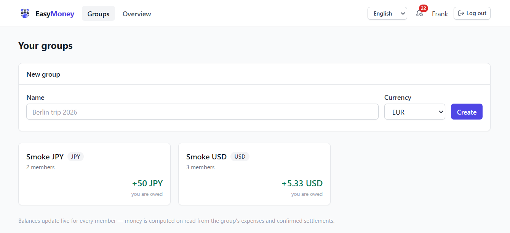

<p align="center">
  
</p>

# EasyMoney — Shared Expenses

> ⚠️ **THIS PROJECT IS LLM-GENERATED** ⚠️
>
> This project was created for test real limits of my local Qwen 3.8 27B LLM setup with 128k context size.
> Yep — it runs fully locally, with no Claude, ChatGPT, Gemini, or other cloud-based LLMs involved.
> Feel free to suggest improvements, point out issues, or share ideas on how I could make the project better!

A client–server web application for managing shared expenses — for a trip, a shared apartment, or any group. It tracks who paid for whom, who owes what to whom, suggests the minimal set of transfers to settle all debts, and keeps every member (and every open tab) in sync in real time.

> **Status:** implemented. `docker compose up --build` brings up the whole stack (see Quick start).
> See [AGENTS.md](AGENTS.md) for the full semantic rules (splitting, balances, settlements, reminders) and coding conventions.

<p align="center">
  
</p>

---

## Features

| Area | What you get |
|---|---|
| **Accounts** | Registration and login with email + password (JWT access + refresh tokens, refresh revocation). |
| **Groups** | Create groups; each group has **its own currency** (ISO 4217). Invite members **by link or by email** (invites expire after 7 days and can be revoked). |
| **Expenses** | Who paid, amount, and how it is split: **equally**, **by shares** (weights), or **by exact amounts**. Every expense has a category, a date, an optional comment, and an optional **receipt file** upload. Expenses can be edited and deleted. |
| **Balances** | Per-member balance in each group, who-owes-whom pairs, and a **combined view across all groups** (per currency). The sum of all balances in a group is always exactly **zero**. |
| **Debt settlement** | Full or partial payments, proposed by the debtor. A settlement is **pending until the recipient confirms**; the recipient can also decline, and the sender can cancel. Only confirmed settlements count toward balances. |
| **Debt optimizer** | The app suggests an **optimal set of transfers** (greedy matching, at most `n−1` transfers) to settle all debts in a group. |
| **Activity feed** | Per-group feed of everything that happened: expenses added/edited/deleted, settlements proposed/confirmed/rejected/cancelled, members joined/left, group closed/reopened. |
| **Notifications** | In-app notification bell + real-time push. Participants and the payer are notified whenever an expense involving them is **added or edited**. |
| **Reminders** | If a debt remains unpaid beyond a configurable number of days (default 7), the debtor gets an **email** listing the amount owed and to whom. At most **once per week** per member per group, never if the debt is already settled. |
| **Close & reopen** | The group owner can **close** a group: no new expenses can be added, and every member receives a **final summary email** (who owes what to whom). The group can be **reopened**. |
| **Multi-tab** | Two or more open tabs of the same user stay perfectly in sync (per-user WebSocket fan-out + stateless REST). |

---

## Architecture

```
                 ┌───────────────┐
   two+ tabs ──▶ │   frontend    │
   (React SPA)   │ nginx + static│──── REST /api/* ────┐
                 └───────────────┘                     │
                       │  ▲                            ▼
                       │  │ WebSocket /ws      ┌───────────────────┐
                       └──┴───────────────────▶│      backend      │
                        (one socket per tab)   │ FastAPI, async    │
                                               │ (Python 3.12)     │
                                               └──┬──────────┬─────┘
                                              SQL │          │ SMTP
                                        ┌─────────▼──┐  ┌────▼─────────┐
                                        │ PostgreSQL │  │   mailpit    │
                                        │     16     │  │ (dev mail)   │
                                        └────────────┘  └──────────────┘
```

- **`frontend/`** — React 18 + TypeScript (Vite), TanStack Query, served by nginx. nginx proxies `/api/*` and `/ws` to the backend, so there are no CORS issues in production.
- **`backend/`** — FastAPI (async), SQLAlchemy 2.0 + asyncpg, Alembic migrations, Pydantic v2, APScheduler for reminder emails, aiosmtplib for mail.
- **`postgres`** — `postgres:16` with a named volume.
- **`mailpit`** — dev-only SMTP server so invites/reminders can be inspected in a browser (http://localhost:8025). In production, point `SMTP_*` vars at a real provider.

**Emails in dev.** All transactional email (invite, overdue reminder, close summary) goes to the bundled mailpit — open the Web UI at http://localhost:8025 to see exactly what recipients get (each email carries the app icon). No preview files are generated; just trigger the event (send an invite, wait for the hourly reminder scan, close a group) and inspect mailpit.

**Real-time sync model.** Every authenticated browser tab opens one WebSocket to `/ws`. The server keeps an in-memory registry of sockets per `user_id` and fans every group event out to **all** sockets of that user — this is what makes multiple tabs of the same user (and multiple devices) update instantly and identically. Every event carries a fresh balance snapshot, and every REST response is computed on read from the database, so there is no stale shared state. (The registry is in-process: v1 runs a single backend replica; scaling out horizontally would add a WS pub/sub broker, see Roadmap.)

---

## Tech stack

| Layer | Choice |
|---|---|
| Backend framework | FastAPI + Uvicorn |
| ORM / DB driver | SQLAlchemy 2.0 (async) + asyncpg |
| Migrations | Alembic |
| Validation / settings | Pydantic v2, pydantic-settings |
| Passwords | Argon2id (argon2-cffi) |
| Auth | JWT access token (15 min) + refresh token (7 days, persisted jti, revocable) |
| Real-time | WebSocket (native FastAPI), per-user connection fan-out |
| Background jobs | APScheduler (AsyncIOScheduler) — hourly reminder scan |
| Mail | aiosmtplib; SMTP via env vars, log-only in dev |
| Files | Local disk under a Docker volume (`/data/uploads`), size-limited |
| Frontend | React 18 + TypeScript + Vite |
| Frontend data | TanStack Query (REST) + WebSocket event bus that invalidates/updates the cache |
| Frontend styling | Tailwind CSS |
| Forms | react-hook-form + zod |
| DB | PostgreSQL 16 |
| Packaging | Docker + docker compose (one command up) |

---

## Quick start

Prerequisites: Docker + Docker Compose.

```powershell
docker compose up --build
```

Then:

- App: **http://localhost:8081**
- API docs (OpenAPI, **disabled by default** — enable with `EXPOSE_API_DOCS=true`, see [API docs](#api-docs-swagger--redoc)): **http://localhost:8081/api/docs**
- Dev mail (invites, reminders, close summaries): **http://localhost:8025**

Migrations run automatically in the backend entrypoint before the server starts. Stop with `Ctrl+C`; data persists in the `pgdata` volume.

### Environment

Copy the values from the table below into `.env` (a `.env.example` will ship with the code). Defaults work out of the box for local development.

| Variable | Default | Meaning |
|---|---|---|
| `POSTGRES_USER` / `POSTGRES_PASSWORD` / `POSTGRES_DB` | `easymoney` / `easymoney` / `easymoney` | DB credentials |
| `DATABASE_URL` | composed from the three above | Explicit override if needed |
| `JWT_SECRET` | placeholder in `.env.example` (replace it) | HMAC secret for JWTs. **Required** — with the default `DEBUG=false` the app refuses to start unless a strong value (≥ 32 chars) is set; only `DEBUG=true` auto-generates one per boot. A weak secret (short or a known dev default) warns in `DEBUG` and fails otherwise. |
| `JWT_ACCESS_TTL_MIN` | `15` | Access token lifetime |
| `JWT_REFRESH_TTL_DAYS` | `7` | Refresh token lifetime |
| `DEBUG` | `false` (compose default) | Debug mode (SQL echo); `true` also allows the auto-generated/weak `JWT_SECRET`. |
| `EXPOSE_API_DOCS` | `false` (app and compose default) | Mounts the generated OpenAPI documentation (Swagger UI, ReDoc, spec JSON). Off by default so deployments don't expose the API surface; set `true` to enable `/api/docs`. |
| `SMTP_HOST` / `SMTP_PORT` / `SMTP_USER` / `SMTP_PASSWORD` / `SMTP_FROM` / `SMTP_USE_TLS` | unset | Real SMTP; mail is log-only whenever `SMTP_HOST` is unset (independent of `DEBUG`) |
| `SMTP_ENABLED` | `true` | Master switch for all outbound mail. `false` = never send (log only, even with `SMTP_HOST`), and all confirmation flows are skipped (register + email change apply immediately) |
| `EMAIL_REGISTER_CONFIRMATION` | `false` | Require email confirmation after registration (active only when `SMTP_ENABLED` is `true`) |
| `EMAIL_CHANGE_CONFIRMATION` | `false` | Require confirmation (sent to the previous address) on email change (active only when `SMTP_ENABLED` is `true`) |
| `REGISTRATION_OPEN` | `true` | When `false`, only the first user can register (while the users table is empty); after that registration is closed (403) and the register form is hidden |
| `MAX_AVATAR_MB` | `2` | Max raw size of a user avatar upload (stored as base64 in the DB) |
| `FRONTEND_URL` | `http://localhost:8081` | Used to build invite links in emails |
| `DEBT_OVERDUE_DAYS` | `7` | Debt older than this is "overdue" (reminders) |
| `REMINDER_INTERVAL_DAYS` | `7` | Minimum days between two reminder emails (same member, same group) |
| `INVITE_EXPIRY_DAYS` | `7` | Lifetime of an invitation |
| `MAX_UPLOAD_MB` | `10` | Receipt file size limit |
| `CORS_ORIGINS` | `http://localhost:8081` | Allowed origins (only relevant if frontend not behind the same nginx) |
| `UPLOAD_DIR` | `/data/uploads` | Where receipt files are stored (Docker volume) |

### API docs (Swagger / ReDoc)

The backend generates an OpenAPI document and mounts the interactive docs behind `/api`:

| What | Via the frontend (nginx proxy) | Direct on the backend |
|---|---|---|
| Swagger UI | http://localhost:8081/api/docs | http://localhost:8000/api/docs |
| ReDoc | http://localhost:8081/api/redoc | http://localhost:8000/api/redoc |
| OpenAPI spec (JSON) | http://localhost:8081/api/openapi.json | http://localhost:8000/api/openapi.json |

**How to enable / disable.** The routes are gated by the `EXPOSE_API_DOCS` env var:

- **Default: off.** Neither the app nor docker compose mount the docs — `/api/docs`, `/api/redoc` and `/api/openapi.json` return 404.
- **To enable** (local dev, or a deployment where you want the docs public): set `EXPOSE_API_DOCS=true` in your `.env` and restart the backend (`docker compose up -d backend`).
- If you do expose the docs in production, restrict access to them at the proxy (authentication or IP allow-list) — the docs themselves have no login.

Auth for the docs: no login is needed to *view* the docs; to *try* endpoints, click **Authorize** in Swagger and paste an access token (`POST /api/auth/login` returns one).

---

## Project structure

```
EasyMoney/
├── README.md
├── AGENTS.md
├── LICENSE                      # GPL-3.0
├── docker-compose.yml
├── .env.example
├── .gitignore
├── .gitattributes
├── backend/
│   ├── Dockerfile
│   ├── pyproject.toml
│   ├── alembic.ini
│   ├── migrations/                  # Alembic versions
│   ├── tests/                       # pytest: invariants, splits, balances,
│   │                                #   settlements, reminders, WS, concurrency
│   └── app/
│       ├── main.py                  # app factory, error mapping, WS mount
│       ├── core/                    # config, security (JWT/argon2), deps, errors
│       ├── db/                      # engine, session, base
│       ├── models/                  # ORM models (one module per aggregate)
│       ├── schemas/                 # Pydantic request/response schemas
│       ├── api/                     # thin routers: auth, me, groups, invites,
│       │                            #   expenses, settlements, balances, feed, notifications
│       ├── services/                # business logic (the only layer that knows
│       │   ├── splits.py            #   the split/balance formulas):
│       │   ├── balances.py          #   per-user, pairwise, cross-group, greedy optimizer
│       │   ├── currency.py          #   precision map, Decimal <-> minor units, money strings
│       │   ├── settlements.py       #   settlement lifecycle
│       │   ├── notifications.py     #   in-app bell rows
│       │   ├── reminders.py         #   FIFO debt aging + overdue scan
│       │   └── mail.py              #   templates + SMTP / log transport
│       ├── workers/                 # APScheduler: hourly overdue-debt scan
│       └── ws/                      # WS endpoint, per-user registry, post-commit hook
└── frontend/
    ├── Dockerfile
    ├── nginx.conf                   # SPA + /api & /ws proxy
    └── src/
        ├── api/                     # fetch wrapper (token, refresh-once) + typed endpoints
        ├── ws/                      # WebSocket client (reconnect, pings) + event bus
        ├── query/                   # TanStack Query keys/mutations + WS cache wiring
        ├── lib/                     # money/split/date helpers (integer minor units only)
        ├── pages/                   # Auth, Invite, Groups, Group, Overview
        └── components/              # ExpenseForm, ExpenseList, Balances, Settlements,
                                     #   Feed, InvitePanel, PeoplePanel, NotificationsBell…
```

---

## API overview

All endpoints are under `/api` and require `Authorization: Bearer <access token>` except the `/auth/*` endpoints. WebSocket at `/ws?token=<access token>`.

| Method & path | Purpose |
|---|---|
| `POST /auth/register` · `POST /auth/login` · `POST /auth/refresh` · `POST /auth/logout` | Account system (logout revokes the refresh token) |
| `GET /me` · `PATCH /me` | Profile |
| `GET /groups` · `POST /groups` | List my groups (with current balance chip) / create (name + currency) |
| `GET /groups/{id}` · `PATCH /groups/{id}` | Group detail / rename |
| `POST /groups/{id}/invites` · `GET /groups/{id}/invites` · `DELETE /invites/{id}` | Create (link or email) / list / revoke invitations |
| `POST /invites/accept` | Accept an invite by token (requires a logged-in account; unauthenticated visitors register first, then accept) |
| `GET /groups/{id}/members` · `POST /groups/{id}/members/leave` · `DELETE /groups/{id}/members/{uid}` | Members / leave / remove (owner only) |
| `GET /groups/{id}/expenses` · `POST /groups/{id}/expenses` | List / add expense (split is computed **server-side**) |
| `GET /expenses/{eid}` · `PATCH /expenses/{eid}` · `DELETE /expenses/{eid}` | Detail / edit (creator or owner) / delete (creator or owner, soft delete) |
| `POST /expenses/{eid}/receipt` · `DELETE /expenses/{eid}/receipt` | Upload (multipart) / remove receipt file |
| `GET /attachments/{id}` | Download receipt (group members only) |
| `GET /groups/{id}/balances` | Per-member balances, who-owes-whom pairs, suggested transfers |
| `GET /balances/all` | Cross-group combined balances, grouped by currency |
| `POST /groups/{id}/settlements` · `GET /groups/{id}/settlements` | Propose a payment (full/partial) / list settlements |
| `POST /settlements/{sid}/confirm` · `/reject` · `/cancel` | Recipient confirms / declines; sender cancels |
| `GET /groups/{id}/activity?limit=&cursor=` | Group activity feed (paginated, newest first) |
| `GET /notifications` · `POST /notifications/read` | Notification bell (list / mark read) |
| `WS /ws?token=…` | Real-time event stream (see AGENTS.md for the event catalogue) |
| `POST /groups/{id}/close` · `POST /groups/{id}/reopen` | Owner-only; close sends the final summary email |

---

## Key rules (summary)

The authoritative, detailed versions live in [AGENTS.md](AGENTS.md) — implement exactly those.

- **No lost fractional units.** All money is `Decimal` (stored `NUMERIC(14,3)`), never floats. For an equal split of `A` among `n`: everyone gets `floor(A/n)`; the leftover fractional units (0 … n−1) go one by one to the **earliest-joined** participants (stable order: join time, then user id). Example: `100.00 / 3 → 33.34 + 33.33 + 33.33` (first in join order). For share-weighted splits the same guarantee holds via the largest-remainder method. Exact-amount splits must sum to the total or the server rejects them.
- **Balances are computed on read** (SQL aggregate over expenses + confirmed settlements), never cached in a mutable column. This makes the edit/delete-recalculation requirement, concurrent additions, and the "sum of all balances = 0" invariant automatic.
- **Settlement lifecycle:** `pending → confirmed | rejected | cancelled`. Only `confirmed` moves money in the balances. A proposed amount is validated against the current pairwise debt at proposal time; if the debt shrinks before confirmation, the confirmed payment is still applied (it may create a reverse debt — that's correct accounting, the payment really happened).
- **Optimal settlement suggestion:** greedy matching of largest debtor with largest creditor, at most `n−1` transfers; total transferred always equals total debt.
- **Overdue reminders:** FIFO attribution of settlements to owed expenses (oldest first). A debtor is overdue when their oldest still-unpaid owed expense is older than `DEBT_OVERDUE_DAYS`. One email per member per group per `REMINDER_INTERVAL_DAYS`, re-verified at send time; applies to closed groups until settled.
- **Closing:** blocks new expenses (other writes still work), emails the final summary to all members; reopening lifts the block.

---

## Implementation notes (spec deviations)

Two places where the implementation makes an explicit choice the spec leaves open, recorded here for traceability:

| Item | As built | Rationale |
|---|---|---|
| `POST /invites/accept` | Requires `Authorization: Bearer <access token>` | The acceptance rule ("user not already a member") needs a resolved caller. A fresh registrant already holds an access token by the time they accept the link, so the login/register-then-join flow still works in one browser session. |
| Owner leaving the group | The group owner cannot leave (`409 Conflict`) | A group must always have an owner (close/reopen/remove are owner-only). Close the group instead. |

AGENTS.md is the binding spec; if this README and AGENTS.md ever disagree, AGENTS.md wins.

---

## Decisions & rationale

| Decision | Rationale |
|---|---|
| FastAPI | Native async WebSocket support (real-time requirement), async SQLAlchemy/asyncpg, automatic OpenAPI docs. |
| WebSocket over SSE/polling | Bidirectional, per-tab connection, lowest latency for "updated immediately for all members"; trivially multi-tab since each tab has its own socket. |
| Earliest-joiners-first for leftover units | Deterministic, stable, independent of request order; matches the intuition that the person in the group longest "absorbs" the rounding residue. |
| Compute balances on read, no stored totals | Guarantees the sum-zero invariant, correct recalculation after edits/deletes, and concurrency safety without locks or event-sourced replays. |
| Pending settlements don't affect balances | A proposal is an offer, not money; only confirmation (a real payment) changes balances. |
| Per-currency groups, no FX conversion | Cross-group view sums per currency only; converting currencies requires a rate source and audit semantics — deliberately out of scope for v1. |
| Soft delete for expenses | The activity feed must remain an honest history ("Alice deleted an expense"), and recalculation simply excludes deleted rows. |
| mailpit in compose | Zero-config local mail testing; production swaps in real `SMTP_*` vars. |

---

## Deployment notes

- **Rate limiting is a proxy responsibility.** The app does no in-request throttling by design (a limiter would add a dependency); put it in front of nginx/backend (e.g. nginx `limit_req`, Caddy, or your CDN/edge WAF) if you expose it beyond your trusted network.
- **Docs off by default.** The OpenAPI docs (`/api/docs`, `/api/redoc`, `/api/openapi.json`) are not mounted unless `EXPOSE_API_DOCS=true`, and the backend port is not published by default (only the frontend on :8081 is). Enable both per-environment as needed.

## License

This project is licensed under the [GNU General Public License v3.0](LICENSE) (GPL-3.0).

## Out of scope / roadmap

- Multi-currency group and automatic currency conversion (groups are single-currency by design; cross-group totals are per-currency).
- Horizontal backend scaling behind a load balancer (needs a WS pub/sub broker, e.g. Redis).
- Object storage (S3-compatible) for receipts — v1 uses a Docker volume.
- Mobile app.
- Email verification flow.
